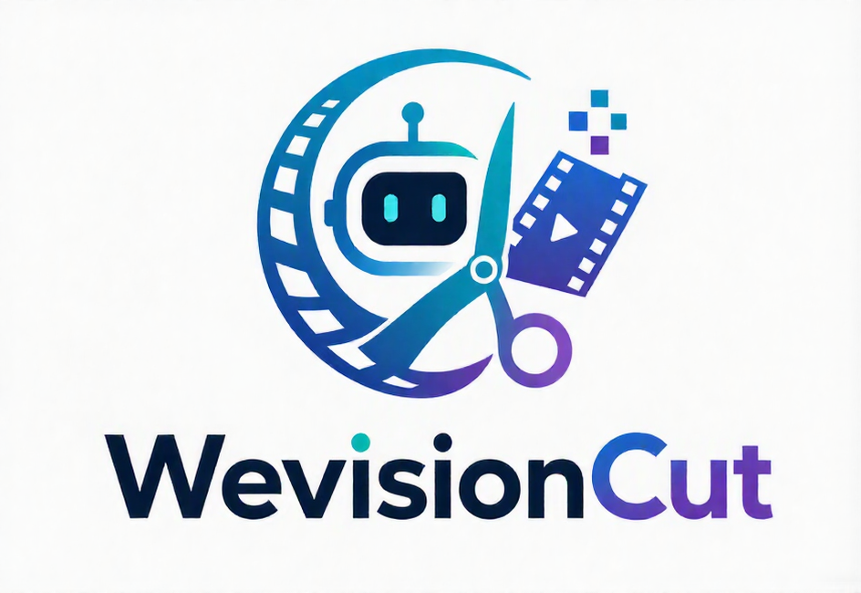
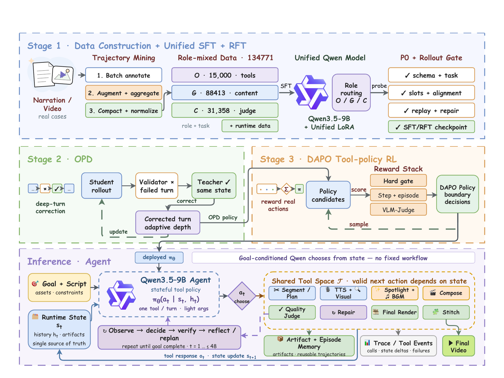

<p align="center">
  
</p>

# WevisionCut

**把知识类长文 / 口播稿做成数分钟成片的长程工具智能体。**

输入一篇长文口播稿。一个 9B 策略模型（[tencent/WevisionCut](https://huggingface.co/tencent/WevisionCut)）一次调用一个工具：切分文章、规划分镜、合成口播、检索素材、填充动画模板、配乐、自审、修复，最后拼接成片。没有手写状态机规定下一步做什么。

[English](README.md) · [中文](README_zh.md) · [模型](https://huggingface.co/tencent/WevisionCut) · [代码](https://github.com/Tencent/WevisionCut)



[下载总览图 PDF](assets/overview.pdf)

---

## 能做什么

- **长文视频化。** 知识类长口播进，数分钟成片出（一次典型运行约 12 次工具调用）。
- **Studio。** 实时时间轴（章节、分镜、口播、字幕、素材、模板、BGM、渲染），可暂停 / 继续，成片后支持**手动剪辑**和**对话改片**。
- **与训练对齐的推理。** 模型看到的 12 个工具和状态 JSON 与训练时一致。
- **数据管线。** `data_construct_pipeline/` 负责采集训练轨迹（主流程 / 内容生成 / 反思三路）。

---

## 快速启用

**环境：** Python ≥ 3.11；生成需要约 24 GB 显存的 NVIDIA GPU（只看界面用 `--no-model`）。Node 和 ffmpeg 由安装脚本拉取。

```bash
git clone https://github.com/Tencent/WevisionCut.git
cd WevisionCut

pip install -r requirements.txt
# GPU 机器：先装匹配 CUDA 的 torch，再
pip install -r requirements-gpu.txt

bash scripts/setup_external_tools.sh          # ffmpeg、Node、渲染器，约 1.1 GB

pip install -U "huggingface_hub[cli]"
hf download tencent/WevisionCut --local-dir checkpoints/wevisioncut-9b

bash run_studio.sh --check                   # 校验路径，不需要 GPU
bash run_studio.sh                          # 默认 http://<host>:8081/
```

权重在后台加载（约 30–60 秒），界面会立刻打开。权重不在默认目录时：`export WEVISIONCUT_MODEL_PATH=/path/to/WevisionCut`。

访问不了 `github.com` 时，把 `requirements.txt` 里的 git pin 换成 `pip install deepagents==0.7.7`。加载权重需要能识别 `qwen3_5` 的 `ms-swift`（否则设 `AICUT_MS_SWIFT_PATH`）。

只起前端、不加载模型：`bash run_studio.sh --no-model`。

---

## 使用 Studio

1. 打开 `http://<host>:8081/`（trustworthy-cut 界面：`/0907_newvis`）。
2. 粘贴口播 / 知识长文，开始生成。八条轨道随智能体推进填充。
3. 成片后：改某一镜的口播、素材、模板、BGM，或用对话（「把开头第一句改掉」「把 0:15 的画面换掉」）。
4. 重渲染只处理改过的镜头。历史支持版本回滚。

默认素材 / BGM 走公开网络检索（`asset_retrieval_tool`）。在 `studio_config.yaml` 里可改成你自己的 HTTP 接口、本地文件夹或 Python 插件，见 [`docs/providers.md`](docs/providers.md)。日常只改这一份配置即可。

```bash
python3 -m studio.config --summary
```

---

## 数据轨迹标注管线

[`data_construct_pipeline/`](data_construct_pipeline/README_zh.md) 用来**标注长程轨迹**：一篇口播稿进 → 一条成片 + 三路角色数据（主流程、内容生成、反思修复）。Studio 负责*部署*训练好的策略；这个包负责*采出*训练数据。

```bash
pip install -e data_construct_pipeline
longvideo-polar smoke --pipeline-root .     # 离线接线检查，不需要 GPU
longvideo-polar run --script-file /path/to/script.txt --output ./rollouts/demo
```

完整 rollout 还需要已启动的 OpenAI 兼容模型、TTS 和 ffmpeg。批量任务与三路落盘格式见管线 [README](data_construct_pipeline/README_zh.md)。

---

## 工作方式（简要）

每一步策略看到当前剪辑状态，从 12 个工具里发出**一次**调用。护栏可以拒绝非法调用，但不会替模型另选工具。

| 工具 | 作用 |
|---|---|
| `Tool_SegmentArticle` | 把长文切成章节 |
| `Tool_PlanShots` | 为章节规划分镜 |
| `Tool_GenerateAudio` | TTS，锁定镜头时长 |
| `Tool_RetrieveVisual` | 检索画面素材 |
| `Tool_DecorateShot` | 模板与填槽 |
| `Tool_TimelineCompose` | 渲染单镜 |
| `Tool_MusicSearch` | 配乐 |
| `Tool_TextQuickJudge` / `Tool_VLMRenderJudge` | 质量门 |
| `Tool_SelfReflect` | 下一步修什么 |
| `Tool_ModalProbe` | 外部服务预检 |
| `Tool_StitchVideo` | 拼接成片 |

更多说明：[`docs/architecture.md`](docs/architecture.md)。配置：[`docs/configuration.md`](docs/configuration.md)。大文件下载：[`docs/external_tools.md`](docs/external_tools.md)。

提示词和状态 JSON 里的 `AICutPipeline` 是训练时的内部名，为保持分布一致未改。

---

## 测试（离线，不需要 GPU）

```bash
python3 tests/test_studio_offline.py
python3 -m pytest tests/test_aicut_agent.py tests/test_providers.py tests/test_thinking_parse.py
node tests/test_frontend.js
```

| 现象 | 查看 |
|---|---|
| 缺模块 | `requirements.txt` / `requirements-gpu.txt` |
| 模型一直 loading | 日志；`checkpoints/wevisioncut-9b`（或 `WEVISIONCUT_MODEL_PATH`）；GPU 是否可见 |
| 某个工具反复失败 | 前端终端，多半是 TTS / 检索 / 渲染 |
| thinking 面板空白 | `model.enable_thinking: true` |
| 端口占用 | `bash run_studio.sh --port <空闲端口>` |

## 许可

Apache License 2.0，见 [LICENSE](LICENSE)。第三方运行时与检索到的素材保留各自授权。
